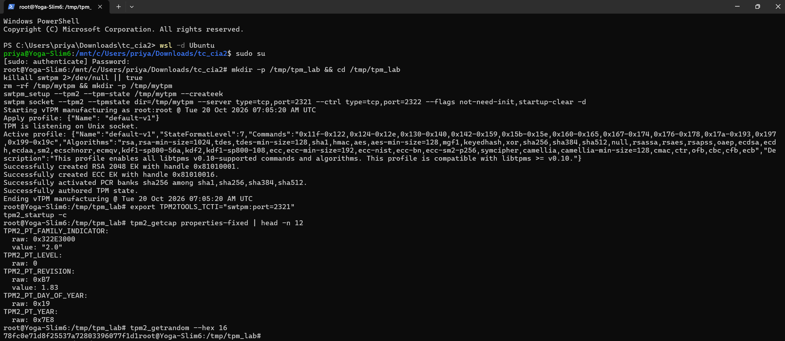
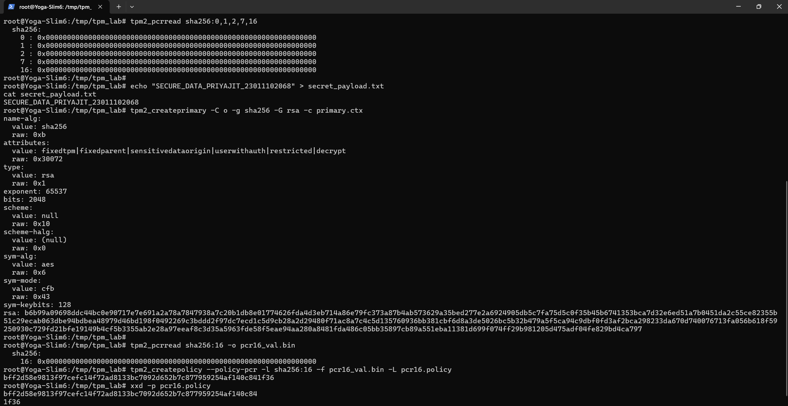
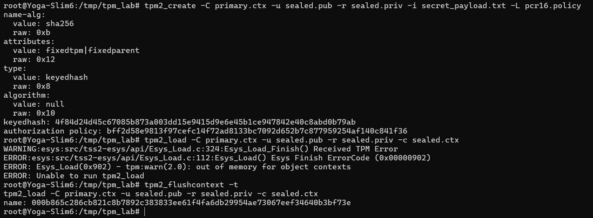
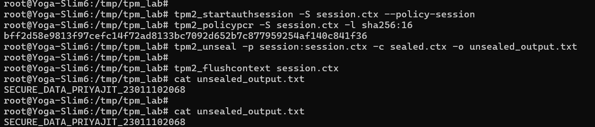
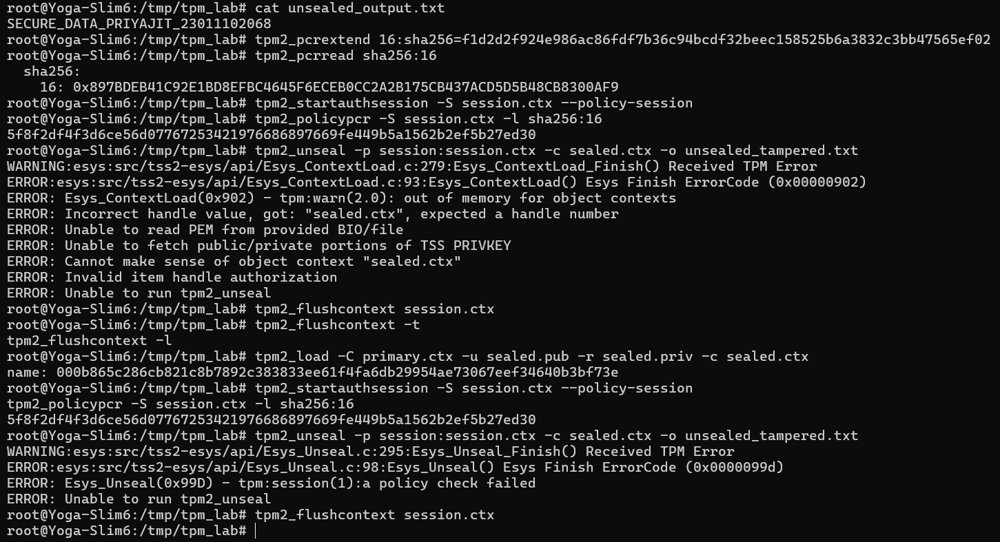

# CS4005: Trusted Computing and Security Models - CIA 2

**Student**: Priyajit Biswal  
**Registration Number**: 23011102068  
**Course**: CS4005 - Trusted Computing and Security Models  
**Topic**: TPM-Based Secure Key Storage and Data Sealing  
**Repository**: [priyajitbiswal/trusted-computing-tpm-lab](https://github.com/priyajitbiswal/trusted-computing-tpm-lab)

---

## Overview

This repository contains the complete implementation, analytical documentation, and submission artifacts for CIA-2. The assignment demonstrates hardware-backed security using a Trusted Platform Module (TPM 2.0).

### Key Objectives
1. **Measured Boot & Root of Trust (RoT)**: Understanding how the Core Root of Trust for Measurement (CRTM) and Platform Configuration Registers (PCRs) record boot integrity.
2. **Remote Attestation**: Demonstrating how cryptographic quotes signed by Attestation Identity Keys (AK) allow remote servers to verify client platform integrity.
3. **Trusted Execution Environment (TEE)**: Understanding CPU-level isolation via ARM TrustZone (Normal World vs. Secure World).
4. **TPM Data Sealing**: Creating an RSA storage key, sealing confidential data against a PCR 16 authorization policy, verifying successful unsealing under a clean state, and demonstrating hardware rejection when the PCR state is altered.

---

## Repository Structure

```
├── Trusted-Computing-CIA2.docx          # Final report (Word document)
├── Assignment2_23011102068.pdf          # Final report (PDF document)
├── README.md                           # Documentation, screenshots, and reproduction guide
├── .gitignore                          # Ignores Word temp files, Python cache, and OS files
├── run_lab.sh                          # Bash script to run all lab steps end-to-end
├── run_lab.py                          # Python automation script for the lab
├── report_images/                      # Terminal execution screenshots
│   ├── 1.png                           # Task 1: Environment setup and TPM verification
│   ├── 2a.png                          # Task 2: Payload and primary key creation
│   ├── 2b.png                          # Task 2: PCR 16 policy generation and data sealing
│   ├── 3a.png                          # Task 3A: Successful unsealing under valid policy
│   └── 3b.png                          # Task 3B: Tamper simulation and unsealing rejection
└── tpm_lab/                            # Generated TPM contexts, policies, and keys
    ├── secret_payload.txt              # Confidential student payload
    ├── primary.ctx                     # Storage primary key handle
    ├── pcr16_val.bin                   # Extracted PCR 16 reference state
    ├── pcr16.policy                    # Computed PCR authorization policy digest
    ├── sealed.pub                      # Public portion of sealed object
    ├── sealed.priv                     # Private encrypted portion of sealed object
    ├── sealed.ctx                      # Loaded sealed object context
    ├── unsealed_output.txt             # Successfully unsealed payload
    └── execution_results.json          # Machine-readable output logs
```

---

## Prerequisites

The lab was conducted inside Ubuntu Linux (WSL2) using the standard `tpm2-tools` suite and the software TPM emulator `swtpm`.

Install the required packages:
```bash
sudo apt-get update
sudo apt-get install -y swtpm swtpm-tools tpm2-tools xxd
```

---

## Lab Execution & Reproduction Guide

### Quick Run
To run all tasks automatically via the provided shell script:
```bash
chmod +x run_lab.sh
./run_lab.sh
```

---

### Step-by-Step Manual Commands

#### 1. Setup and Initialize Software TPM
```bash
mkdir -p /tmp/tpm_lab && cd /tmp/tpm_lab
killall swtpm 2>/dev/null || true
rm -rf /tmp/mytpm && mkdir -p /tmp/mytpm

# Setup and launch swtpm in daemon mode on socket ports 2321/2322
swtpm_setup --tpm2 --tpm-state /tmp/mytpm --createek
swtpm socket --tpm2 --tpmstate dir=/tmp/mytpm \
    --server type=tcp,port=2321 \
    --ctrl type=tcp,port=2322 \
    --flags not-need-init,startup-clear -d

# Point tpm2-tools to swtpm socket
export TPM2TOOLS_TCTI="swtpm:port=2321"
tpm2_startup -c
```

#### 2. Task 1: Environment Setup and TPM Verification
Verify the TPM capabilities, random number generator, and clean PCR state:
```bash
tpm2_getcap properties-fixed | head -n 12
tpm2_getrandom --hex 16
tpm2_pcrread sha256:0,1,2,7,16
```
**Observation**: Confirmed TPM 2.0 (revision 1.83), true random number generation output, and clean SHA-256 PCR bank initialized to thirty-two zeros.



#### 3. Task 2: TPM Key Creation and Data Sealing
Create the secret file, generate the primary storage key, compute the policy digest, and seal the object:
```bash
# Create secret payload
echo "SECURE_DATA_PRIYAJIT_23011102068" > secret_payload.txt

# Create primary key under the Owner hierarchy
tpm2_createprimary -C o -g sha256 -G rsa -c primary.ctx

# Extract current PCR 16 value and compute authorization policy digest
tpm2_pcrread sha256:16 -o pcr16_val.bin
tpm2_createpolicy --policy-pcr -l sha256:16 -f pcr16_val.bin -L pcr16.policy
xxd -p pcr16.policy

# Seal secret against policy and load into TPM memory
tpm2_create -C primary.ctx -u sealed.pub -r sealed.priv -i secret_payload.txt -L pcr16.policy
tpm2_flushcontext -t
tpm2_load -C primary.ctx -u sealed.pub -r sealed.priv -c sealed.ctx
```
**Policy Digest Generated**: `bff2d58e9813f97cefc14f72ad8133bc7092d652b7c877959254af140c841f36`





#### 4. Task 3A: Successful Unsealing under Matching Policy
Evaluate the policy session against the untampered PCR 16 register:
```bash
tpm2_startauthsession -S session.ctx --policy-session
tpm2_policypcr -S session.ctx -l sha256:16
tpm2_unseal -p session:session.ctx -c sealed.ctx -o unsealed_output.txt
tpm2_flushcontext session.ctx
cat unsealed_output.txt
```
**Observation**: Session digest matched `bff2d58e...`. Unsealing succeeded and output: `SECURE_DATA_PRIYAJIT_23011102068`.



#### 5. Task 3B: Tamper Simulation and Unsealing Rejection
Simulate an unauthorized change to the system by extending PCR 16:
```bash
# Extend PCR 16 with arbitrary measurement
tpm2_pcrextend 16:sha256=f1d2d2f924e986ac86fdf7b36c94bcdf32beec158525b6a3832c3bb47565ef02
tpm2_pcrread sha256:16

# Reload sealed object after clearing transient handles
tpm2_flushcontext -t
tpm2_flushcontext -l
tpm2_load -C primary.ctx -u sealed.pub -r sealed.priv -c sealed.ctx

# Attempt unseal under tampered state
tpm2_startauthsession -S session.ctx --policy-session
tpm2_policypcr -S session.ctx -l sha256:16
tpm2_unseal -p session:session.ctx -c sealed.ctx -o unsealed_tampered.txt
tpm2_flushcontext session.ctx
```
**Observation**: Extending PCR 16 updated its value to `0x897BDEB4...`. The policy session computed mismatched digest `5f8f2df4...`. The TPM hardware rejected unsealing:
```
ERROR: Esys_Unseal(0x99D) - tpm:session(1):a policy check failed
ERROR: Unable to run tpm2_unseal
```



---

## Error Code Analysis: 0x99D

In the TPM 2.0 specification, error code `0x99D` decomposes as follows:
- `0x900`: TPM 2.0 Response Code Warning / Error indicator.
- `0x09D`: `TPM2_RC_POLICY_FAIL` (Policy check failed).
- `session(1)`: The authorization session passed in parameter 1 did not reach the target authorization state required by the object.

Because the system state was modified, the session hash did not match the policy digest baked into the sealed private file. The TPM hardware refused to release the plaintext secret.

---

## Real-World Applications of PCR-Bound Data Sealing

1. **Full Disk Encryption (BitLocker / LUKS)**: Disk encryption keys are sealed to PCR 0 (firmware), PCR 4 (bootloader), and PCR 7 (Secure Boot state). If an attacker boots from a USB stick or tampers with the bootloader, the TPM detects the changed PCR values and refuses to release the key.
2. **Boot-Level Malware Protection**: If a rootkit or malicious firmware update alters boot code, the PCR extension formula (`PCR_new = SHA256(PCR_old || measurement)`) changes the accumulated digest, preventing decryption of critical operational credentials.
3. **Automated Data Center Server Boot**: Remote servers can safely unlock encrypted volumes upon unattended reboot without human intervention, guaranteed that decryption only occurs if the hypervisor and kernel launched untampered.

---

## Conceptual Q&A Summary

- **Q1: TPM Architecture & Measured Boot**: Covers the Cryptographic Coprocessor, NVRAM, PCRs, RNG, and Authorization Logic. Details the CRTM -> UEFI -> Bootloader -> OS chain and the `PCR_new = SHA256(PCR_old || measurement)` extend operation.
- **Q2: Remote Attestation**: Four-step process (AK creation, nonce challenge, PCR Quote generation, and server-side verification) demonstrated through an enterprise corporate network access scenario.
- **Q3: Trusted Execution Environment (TEE)**: Explains ARM TrustZone architecture, including Normal World, Secure World, Non-Secure (NS) bus bit, Secure Monitor (EL3), and Trusted OS (OP-TEE) with an operational biometric unlock flow.
- **Q4: TPM vs. TEE**: Architectural comparison between motherboard-level cryptoprocessor (TPM) and CPU-level isolated execution domain (TEE).
